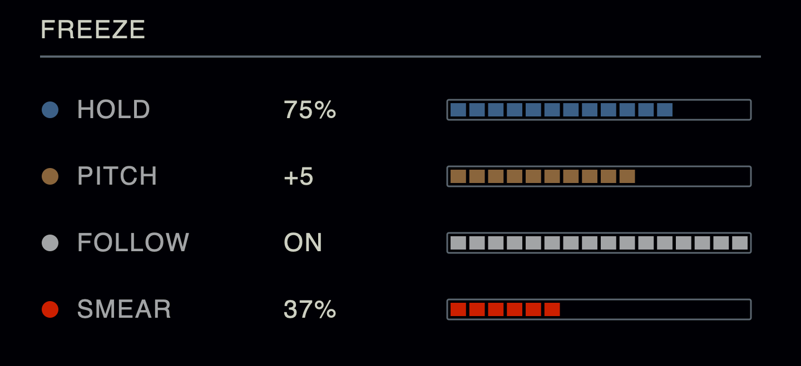

# fx wagons

Four effects for the OP-1 Field's **fx train**, each a pack of its own for [open-field](https://github.com/LaP0573/open-field) (OS 1.7.3+0). Put any of them on the unit and it becomes one more pick on every knob of the train, drawn on its own wagon, with a page of its own a tap away.

| Pack | Effect | Knobs (1st to 4th) |
| --- | --- | --- |
| `juneaux.pack` | **JUNEAUX**: the Juno-60 chorus, with its own faceplate | MODE (I, II, I+II), MIX, DEPTH, TONE |
| `tape.pack` | **TAPE**: a worn tape machine, for mellotron-ish keys and pads. Turned all the way up it gets wobblier, darker and more worn, never fuzzy | WOW, FLUTTER, SATURATE, AGE |
| `gate.pack` | **GATE**: a gate locked to the tempo | DEPTH, PATTERN (1/4, 1/8, 1/16, 1/8t, stab, chrl, sync, trance), LENGTH, SMOOTH |
| `freeze.pack` | **FREEZE**: holds a moment as a pad | HOLD (up from 0 catches, 0 lets go), PITCH (semitones), FOLLOW, SMEAR |

GATE and FREEZE follow the chord of [CHERD](https://github.com/hasis/cherd) when `cherd.pack` is on the unit too. Each wagon is light: 20,000 to 30,000 cycles a block.

## Install

1. open-field for OS 1.7.3 on the unit, with `base.pack` and **`fx train.pack` 11 or later** (the version that takes wagons from other packs).
2. Copy the packs you want from [`field/`](field) into `packs` on the unit's disk, or tick them on open-field's install page.
3. Restart. Open the train (T3 on a synth or drum sound) and turn a knob past the train's own effects.

The lamp's knob never offers them: the firmware's own slot can't carry an effect of a pack. Delete a pack and the train runs as before; a train saved with that wagon loads with the wagon empty.

## On the unit

Tap a wagon's knob for its page. The four knobs turn its values; T3 goes back to the train. The train keeps the values in its file and in its presets.

| | |
| --- | --- |
|  | **JUNEAUX** has a faceplate of its own: the lights over the buttons I and II show the mode, and the two voices weave over the panel at the mode's speed, wider with DEPTH |
|  | **TAPE**: WOW and FLUTTER wobble the pitch, SATURATE warms it (level-matched, no hard clipping), AGE rolls off the top and adds hiss and the odd dropout |
|  | **GATE** chops in time with the tempo and follows a change of BPM |
|  | **FREEZE** catches what's playing as you turn HOLD up and lets it go at 0 |

A wagon switched off (hold its knob) stands on the siding, dimmed:

The pictures are drawn on a Mac from the same picture files the unit draws, with a stand-in for the firmware's letters.

## Source

- **JUNEAUX** is open-field's example of a wagon: [`examples/juneaux`](https://github.com/LaP0573/open-field/tree/main/examples/juneaux) builds `field/juneaux.pack` byte for byte.
- **TAPE, GATE, FREEZE**: [`src/`](src). One source, `fx_pack.cpp`, makes each pack from a two-line file (`tape_pack.cpp` and the others), with a recipe each. The effects come from the chains of our older OP-1 Field firmware: `fx_special.cpp` (GATE, FREEZE), `fx_tape.h` with `fx_tape_wagon.h` (TAPE). `host_check.cpp` runs every wagon on the Mac against its reference and writes WAVs. The table a wagon fills is open-field's `module/op1f_wagon.h`.

MIT licence. JUNEAUX's numbers come from [pendragon-andyh/Juno60](https://github.com/pendragon-andyh/Juno60).
