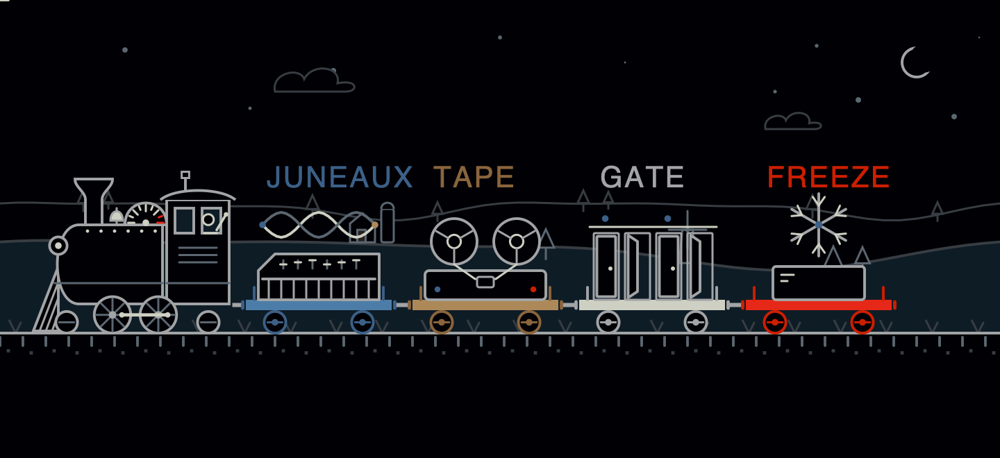
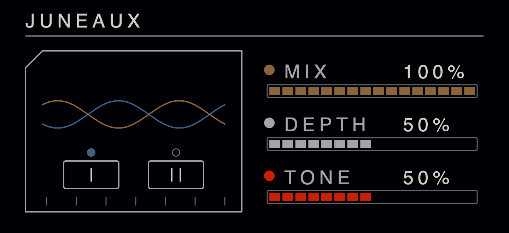
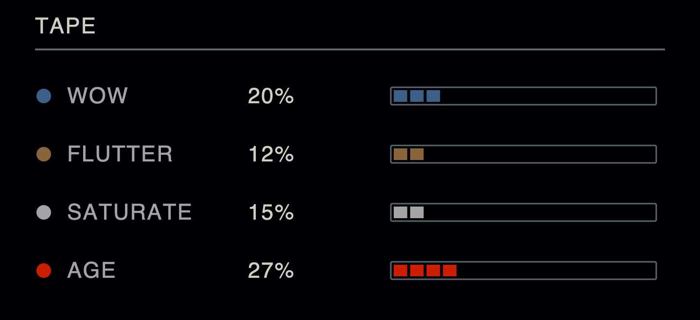
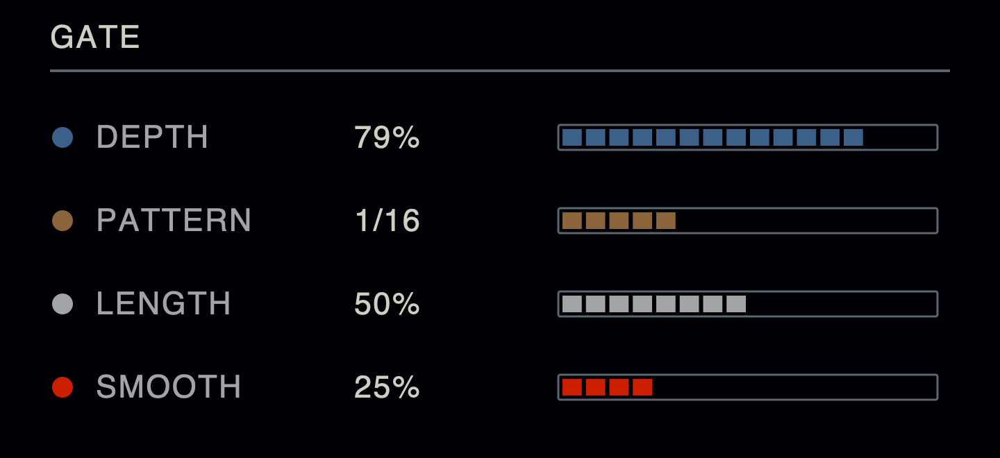
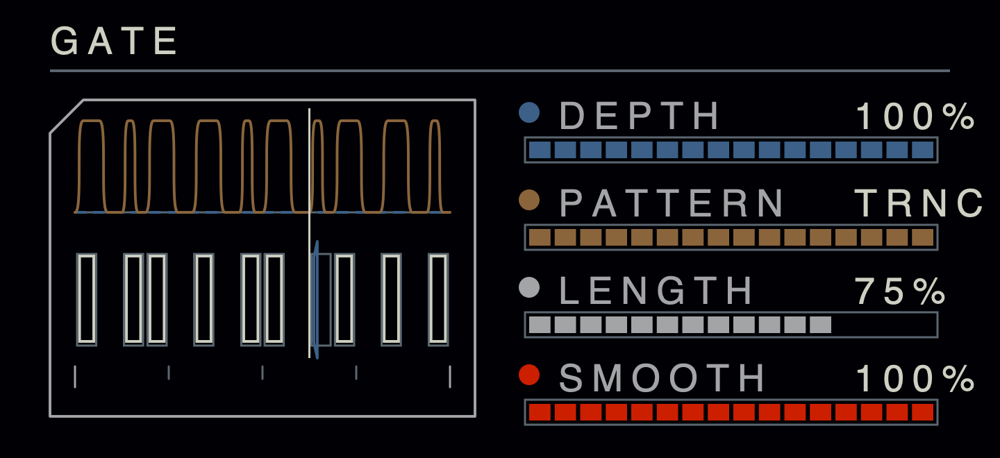
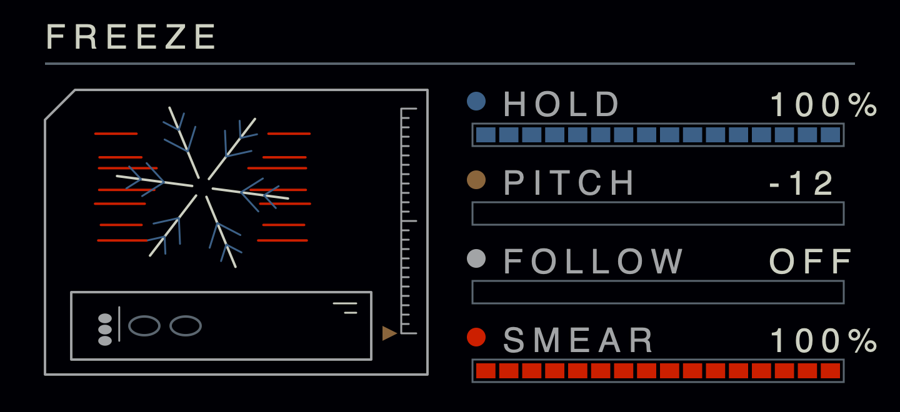
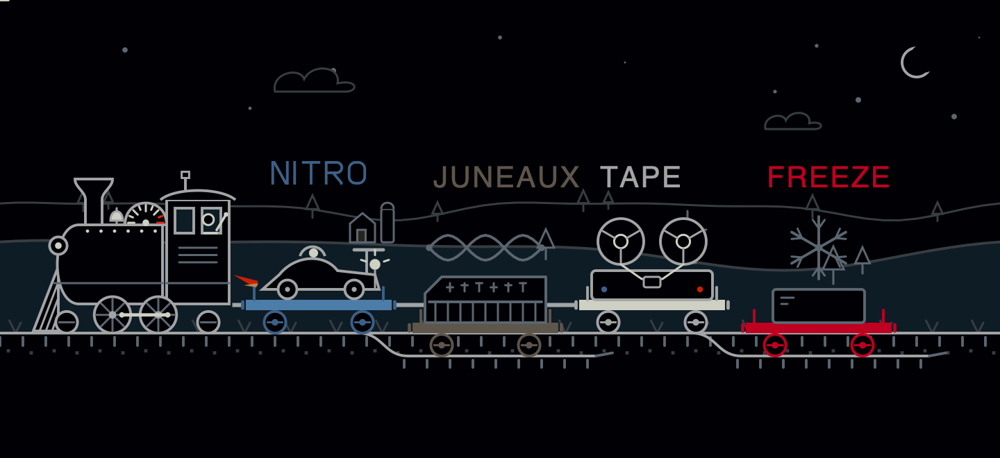

# fx wagons

Four effects for the OP-1 Field's **fx train**, each a pack of its own for [open-field](https://github.com/LaP0573/open-field) (OS 1.7.3+0). Put any of them on the unit and it becomes one more pick on every knob of the train, drawn on its own wagon, with a page of its own a tap away.

| Pack | Effect | Knobs (1st to 4th) |
| --- | --- | --- |
| `juneaux.pack` | **JUNEAUX**: the Juno-60 chorus, with its own faceplate | MODE (I, II, I+II), MIX, DEPTH, TONE |
| `tape.pack` | **TAPE**: a worn tape machine, for mellotron-ish keys and pads. Turned all the way up it gets wobblier, darker and more worn, never fuzzy | WOW, FLUTTER, SATURATE, AGE |
| `gate.pack` | **GATE**: a gate locked to the tempo | DEPTH, PATTERN (1/4, 1/8, 1/16, 1/8t, stab, chrl, sync, trnc), LENGTH, SMOOTH |
| `freeze.pack` | **FREEZE**: holds a moment as a pad | HOLD (up from 0 catches, 0 lets go), PITCH (semitones), FOLLOW, SMEAR |

GATE and FREEZE follow the chord of [CHERD](https://github.com/hasis/cherd) when `cherd.pack` is on the unit too. Each wagon is light: 20,000 to 30,000 cycles a block.

## Install

1. open-field for OS 1.7.3 on the unit, with `base.pack` and **`fx train.pack` 11 or later** (the version that takes wagons from other packs).
2. Copy the packs you want from [`field/`](field) into `packs` on the unit's disk, or tick them on open-field's install page.
3. Restart. Open the train (T3 on a synth or drum sound) and turn a knob past the train's own effects.

The lamp's knob never offers them: the firmware's own slot can't carry an effect of a pack. Delete a pack and the train runs as before; a train saved with that wagon loads with the wagon empty.

## On the unit

Tap a wagon's knob for its page: every wagon has a faceplate of its own that moves with the sound. The four knobs turn its values, read on the right in encoder order; T3 goes back to the train. The train keeps the values in its file and in its presets. On each faceplate a knob's part of the drawing is in that knob's colour, so nothing hangs on telling colours apart.

### JUNEAUX

The lights over the buttons I and II show the mode (1st knob), and the two voices weave over the panel at the mode's speed, wider with DEPTH (3rd).

### TAPE

Two reels turn. WOW (1st) sways their speed and the tape between them, FLUTTER (2nd) makes the tape over the head tremble, SATURATE (3rd) thickens the head and gives it a glow (level-matched, no hard clipping), AGE (4th) scatters specks of wear as the top rolls off and hiss and the odd dropout creep in. All the way up:

### GATE

The bar's openings, drawn from the pattern itself (2nd knob: 1/4, 1/8, 1/16, 1/8t, stab, chrl, sync, trnc), as wide as LENGTH (3rd), square or rounded by SMOOTH (4th); the dashed line is how far DEPTH (1st) shuts it. Below, a door for each hit swings open under a playhead that runs in time with the tempo. The trance pattern, rounded:

### FREEZE

Turn HOLD (1st) up and a flake grows and turns as it catches what's playing; at 0 it lets go. PITCH (2nd) is the marker on a ruler from -12 to +12, FOLLOW (3rd) a chain link that closes when it follows CHERD's chord, SMEAR (4th) the streaks drifting off. Holding all the way, an octave down, smeared:

A wagon switched off (hold its knob) stands on the siding, dimmed:

The pictures are drawn on a Mac from the same picture files the unit draws, with a stand-in as wide as the firmware's letters.

## Source

- **JUNEAUX** is open-field's example of a wagon: [`examples/juneaux`](https://github.com/LaP0573/open-field/tree/main/examples/juneaux) builds `field/juneaux.pack` byte for byte.
- **TAPE, GATE, FREEZE**: [`src/`](src). One source, `fx_pack.cpp`, makes each pack from a two-line file (`tape_pack.cpp` and the others), with a recipe each; `face.py` writes their faceplates (`tape.svg.make` and the others) and the pictures here. The effects come from the chains of our older OP-1 Field firmware: `fx_special.cpp` (GATE, FREEZE), `fx_tape.h` with `fx_tape_wagon.h` (TAPE). `host_check.cpp` runs every wagon on the Mac against its reference and writes WAVs. The table a wagon fills is open-field's `module/op1f_wagon.h`.

MIT licence. JUNEAUX's numbers come from [pendragon-andyh/Juno60](https://github.com/pendragon-andyh/Juno60).
